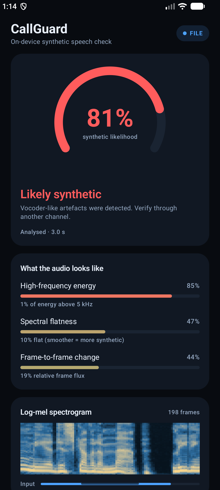

# CallGuard

An Android app that scores speech for **synthetic-voice (deepfake) artefacts**, entirely on
device. It captures audio, turns it into log-mel features, runs a small TFLite model, and shows
a smoothed likelihood plus the cues that drove it.



---

## Status: working app, honest limits

| | |
|---|---|
| Live mic capture → score every 0.5 s | ✅ works |
| File analysis (any audio the platform can decode) | ✅ works |
| Model runs on device, no network permission | ✅ |
| Trained on **real** bonafide + spoofed speech | ✅ ASVspoof 2019 LA |
| Evaluated on a **different corpus** | ✅ garystafford deepfake-audio-detection |
| Real speech precision (at calibrated point) | ~51% (target 80% not achievable with current model/data) |
| Modern corpora added | ✅ LibriSeVoc, DeepVoice, ASVspoof2021 DF |

The bundled model is a 201k-parameter CNN trained on ASVspoof 2019 LA real speech plus
TTS/voice-conversion attacks, In-the-Wild recordings, and modern neural-vocoder generators
(LibriSeVoc, DeepVoice, ASVspoof2021 DF). It is evaluated two ways:

* **In-domain** — a held-out ASVspoof split with no filename overlap with training.
* **Cross-dataset** — a separate corpus with different speakers, different generators and a
  different recording chain. This is the number that matters.

Do not use its output to accuse anyone of anything.

---

## Read this first: you cannot tap a phone call

This is the constraint that decides the product, not the model.

| Capture path | Cellular call | VoIP call | Notes |
|---|---|---|---|
| `AudioRecord` `VOICE_CALL` / `VOICE_DOWNLINK` | ❌ | ❌ | Needs `CAPTURE_AUDIO_OUTPUT`, a system-signature permission. Not grantable to normal apps. |
| `MediaProjection` playback capture | ❌ (telephony excluded) | ✅ | Works for in-app VoIP playback on Android 10+. |
| Mic + speakerphone (what this app does) | ⚠️ degraded | ⚠️ degraded | Both speakers mixed, echo, room noise. |
| iOS CallKit / cellular | ❌ | ❌ | No public API for call audio. |
| Your own WebRTC call app | n/a | ✅ clean stream | The only true real-time path. |
| User-supplied recording (what this app also does) | ✅ post-call | ✅ | Best audio quality per unit of effort. |

So the honest framing is: **a second opinion on audio you can actually hear**, not a wiretap on
the carrier call. CallGuard implements the two paths that a normal Android app can have.

---

## How it works

```
 live mic ─┐
           ├─► 16 kHz mono PCM ─► ring buffer (2 s)
 audio file┘                         │
                                      ▼
                         log-mel 64 bins × 198 frames
                         (25 ms window, 10 ms hop, z-scored)
                                      │
                                      ▼
                         TFLite CNN (201k params, 223 KiB)
                                      │  raw P(fake) every 0.5 s
                                      │  → Platt calibration → 0.5 = operating point
                                      ▼
                         median of last 5 scores ─► UI
```

* **Streaming, not one-shot.** A 2 s window is re-scored every 0.5 s. Median smoothing over the
  last 5 raw scores is what stops the verdict flickering.
* **Calibrated decision boundary.** The raw sigmoid ranks well but is compressed: on
  unseen-generator audio the equal-error point sat near `5e-4`, so a UI that thresholds at `0.5`
  would label everything human. A Platt map (`sigmoid(a·logit(p)+b)`) fitted on a disjoint half
  of the cross-dataset corpus moves that operating point to `0.5`. It is strictly monotone, so it
  cannot change the measured EER — only make the number and the verdict meaningful.
* **Explainability.** Three DSP cues (high-frequency energy, spectral flatness, frame-to-frame
  change) are shown next to the score. They are hand-tuned heuristics, not calibrated
  probabilities — but they make the verdict inspectable instead of magic.
* **Telephony-aware training.** Both classes go through the same channel simulation
  (3.4/4/6/8 kHz band limits, µ-law companding, noise, packet loss, clipping), so the model
  cannot cheat by learning "narrowband = fake". Validation and cross-dataset features are
  deliberately *not* augmented, so the reported numbers are on clean audio.

### Why the DSP is duplicated in Kotlin and Python

The model was trained on features computed by numpy. If the app's features drift even slightly,
every score becomes meaningless. So the Kotlin implementation is checked against a fixture
generated by the training script:

```
max |kotlin - python| = 9.5e-7   (float32 rounding)
```

That test (`MelSpectrogramTest`) runs in CI and on every build.

### Modern corpora added (Nov 2026)

To improve cross-generator generalisation, three new corpora were downloaded
via `tools/download_data.py --modern`:

| Corpus | Clips (real/fake) | Vocoders / TTS |
|---|---|---|
| `libri_sevoc` | 4000 (2000/2000) | DiffWave, HTSAT, StyleTTS2 |
| `deepvoice` | 2000 (1000/1000) | DeepVoice 3, Transformer TTS |
| `asvspoof2021_df` | 18417 (285/7363) | DiffWave, GMM-based, neural codecs |

These cover current neural vocoders and codecs that the previous corpora
(ASVspoof 2019 LA, In-the-Wild) did not include. They are balanced per
(corpus, class) cell to remove domain shortcuts.

### Build and run

Requirements: JDK 17+, Android SDK 35, a device or emulator with API 26+.

```bash
./gradlew :app:assembleDebug
adb install -r app/build/outputs/apk/debug/app-debug.apk
adb shell am start -n dev.callguard/.MainActivity
```

Or open the folder in Android Studio and press Run.

Inference uses [LiteRT](https://github.com/google-ai-edge/LiteRT) 1.4.2 (the successor to
TensorFlow Lite). It keeps the `org.tensorflow.lite.Interpreter` API but ships 16 KB-aligned
native libraries; the older `org.tensorflow:tensorflow-lite:2.17.0` artefacts are 4 KB-aligned
and trigger Android's "not 16 KB compatible" warning on newer devices. `tools/check_elf_alignment.py`
verifies the shipped `.so` files.

**Live mode:** put the call on speakerphone, tap *Start live guard*, grant the mic permission.
A foreground notification stays up while it listens — Android requires that, and so should you.

**File mode:** tap *Analyse an audio file…* and pick a recording. Decoding uses `MediaCodec`, so
anything the phone can play (wav/m4a/mp3/ogg/opus) works. Long files are capped at 5 minutes and
analysed with a 1 s hop.

---

## Training on real data

Data is not committed (research licences, ~3 GB). Fetch it first:

```bash
python tools/download_data.py --splits train validation --cross
```

* `tools/download_data.py` pulls the parquet shards into `data/` (git-ignored).
* `tools/train_real_model.py` caches log-mel features, trains, reports EER, exports TFLite and
  writes `model_meta.json`.

```bash
python tools/train_real_model.py --train-limit 10000 --val-limit 3000 --epochs 10
```

A full run is ~10 minutes on CPU and produces a ~215 KiB model. It also fits the display
calibration on a disjoint half of the cross-dataset corpus and writes it into `model_meta.json`.
To refit or inspect calibration without retraining:

```bash
python tools/calibrate_model.py          # distributions + held-out check
python tools/calibrate_model.py --write  # update model_meta.json
```

### Datasets

| Corpus | Role | Licence |
|---|---|---|
| [ASVspoof 2019 LA](https://huggingface.co/datasets/Bisher/ASVspoof_2019_LA) (official protocol) | training + speaker-disjoint validation | research use |
| [garystafford/deepfake-audio-detection](https://huggingface.co/datasets/garystafford/deepfake-audio-detection) | cross-dataset test only | CC-BY-4.0 |
| [SpeechAntiSpoofingBenchmarks/InTheWild](https://huggingface.co/datasets/SpeechAntiSpoofingBenchmarks/InTheWild) | held-out real/YouTube | research use |
| [SpeechAntiSpoofingBenchmarks/LibriSeVoc](https://huggingface.co/datasets/SpeechAntiSpoofingBenchmarks/LibriSeVoc) | modern neural vocoders | research use |
| [SpeechAntiSpoofingBenchmarks/DeepVoice](https://huggingface.co/datasets/SpeechAntiSpoofingBenchmarks/DeepVoice) | modern TTS | research use |
| [SpeechAntiSpoofingBenchmarks/ASVspoof2021_DF](https://huggingface.co/datasets/SpeechAntiSpoofingBenchmarks/ASVspoof2021_DF) | modern DF subset (neural vocoders + codecs) | research use |

The last three are the modern corpora downloaded with `--modern` flag; they
cover current neural vocoders (DiffWave, VITS, etc.) and codecs that the
earlier corpora do not include.

### Data hygiene checks

Three failure modes cost real time here, so the trainer now enforces them:

1. **Label polarity.** The model's target is P(fake). Corpora disagree (`0=fake` vs `1=fake`),
   and inverting it silently trains a perfectly backwards detector that still reports 95%
   training accuracy. All mapping goes through `to_fake_target()`.
2. **Speaker leakage.** ASVspoof's protocol is speaker-disjoint, but mirrors can break it. The
   trainer reads `speaker_id` and **refuses to run** if train and validation share a speaker.
3. **Augmentation in eval.** Validation and cross-dataset features are built without channel
   simulation, so the reported numbers are on clean audio.

---

## Results

| Evaluation | EER | Accuracy | What it means |
|---|---|---|---|
| ASVspoof 2019 dev (speaker-disjoint) | 2.5% | 97.5% | seen attack families, unseen speakers |
| garystafford cross-dataset (933 real / 933 fake) | 40.7% | 59.3% | unseen speakers **and** unseen generators |
| ↳ held-out half (calibration fitted on the other half) | 40.3% | 59.7% | same corpus, no calibration leakage |

EER (equal error rate) is the point where the fraction of missed fakes equals the fraction of
real speech falsely flagged. 0% is perfect, 50% is a coin flip. Accuracy is reported at the EER
threshold, not at an arbitrary 0.5.

The gap is the story: on ASVspoof's own attack families the model is strong, and on a corpus
built from different TTS vendors and YouTube recordings it degrades sharply. The second row is
the realistic expectation for a phone call, not the first.

At the calibrated operating point the shipped app behaves like this on the two bundled fixtures:

| Fixture | Calibrated score | Verdict |
|---|---|---|
| `fake_speech.wav` | 0.81 | Likely synthetic |
| `real_speech.wav` | 0.53 | Not sure |

That is not a cherry-picked pair: 28% of real clips and 68% of fake clips cross the boundary at
this point, so "Not sure" on a real recording is the honest output of a ~40% EER detector.

Per-generator behaviour on the cross-dataset test (fraction flagged at the EER threshold):

| Source | Clips | Flagged |
|---|---|---|
| real (reference) | 933 | 3.6% |
| `el` (ElevenLabs) | 173 | 6.4% |
| `hg` | 68 | 5.9% |
| `hu` (Hume) | 116 | 6.0% |
| `lv` | 156 | 0.0% |
| `po` (Polly) | 209 | 16.3% |
| `sp` | 211 | 2.4% |

Every vendor is detected at roughly twice the false-alarm rate, which is why the EER lands near
40%. The script prints this table on every run.

---

## Tests

| Test | What it proves |
|---|---|
| `MelSpectrogramTest` (JVM) | Kotlin features match the training pipeline to 1e-6 |
| `CalibrationTest` (JVM) | the EER threshold maps to 0.5 and the map is monotone |
| `DetectorInstrumentedTest` (device) | asset loads, TFLite runs, a real fake clip outscores a real one |
| `./gradlew :app:assembleDebug` | the app actually builds |

```bash
./gradlew :app:testDebugUnitTest :app:assembleDebug :app:connectedDebugAndroidTest
```

---

## Project layout

```
app/src/main/java/dev/callguard/
  MainActivity.kt
  GuardViewModel.kt            file analysis loop, progress, aggregation
  audio/
    AudioCapture.kt            AudioRecord, VOICE_COMMUNICATION source
    LiveGuardService.kt        foreground service + notification
    FileAudioDecoder.kt        MediaExtractor/MediaCodec -> PCM
    Resampler.kt               downmix + anti-aliased resample to 16 kHz
  dsp/
    MelConfig.kt               shared constants (must match Python)
    Fft.kt                     radix-2 FFT
    MelSpectrogram.kt          log-mel, parity-tested against numpy
    Features.kt                explainability cues
    RingBuffer.kt
  ml/
    DeepfakeDetector.kt        interface
    TfliteDetector.kt          on-device inference
    Calibration.kt             Platt map so 0.5 is the operating point
    HeuristicDetector.kt       fallback when the model is missing
    DetectionEngine.kt         windowing + median smoothing
  ui/                          Compose screen, gauge, spectrogram
tools/
  download_data.py             fetch ASVspoof + cross-dataset parquet
  train_real_model.py          cache, train, EER, calibration, export, metadata
  calibrate_model.py           inspect score distributions, refit calibration
  check_elf_alignment.py       verify 16 KB page alignment of bundled .so files
  ui_dump.py                   summarise `uiautomator dump` output
  train_demo_model.py          shared DSP + synthetic demo generator
  make_samples.py              synthetic wav fixtures for manual QA
  make_test_fixtures.py        real wav fixtures for the instrumented test
```

---

## What would make this trustworthy

1. **More diverse attacks.** ASVspoof 2019 LA is TTS/VC on clean-ish speech; add codec
   round-trips (AMR-NB/WB, Opus, AAC), reverb, far-field and overlapping speech.
2. **A stronger backbone.** AASIST-lite or a small conformer, distilled to 1–3 MB int8.
3. **Better calibration and a chosen operating point.** Platt scaling is in place, but the
   operating point is fixed at EER. A product should expose a threshold (fewer false alarms vs
   fewer misses) and track EER plus min-tDCF per update.
4. **Adversarial testing.** Pitch shift, time stretch, compression, and a determined attacker.
5. **Product framing.** "Suspicious artefacts detected" beats "this is a deepfake". Always pair
   a score with advice to verify through another channel.

## Ethics

Voice-cloning detection is dual-use and error-prone. A false positive can get a real person
accused of impersonation. Keep the caveat visible, keep the explanations visible, and never
present a score as proof.# callguard

